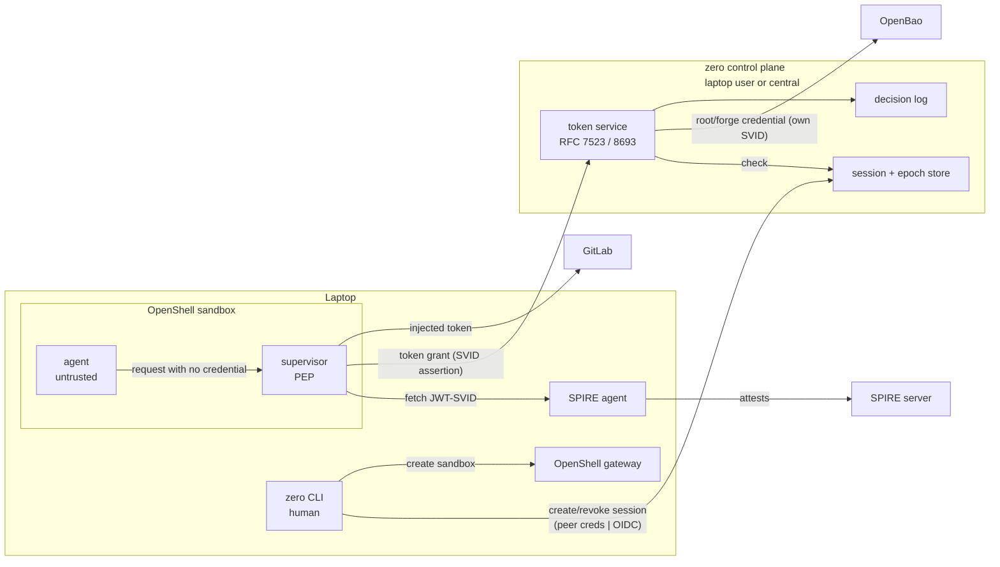

## 27. zero control plane — identity, credential brokering, revocation

Status: **proposed** (ADR 0025). Refines §8, §18, §19, §22 for the implementation on OpenShell.

### 27.1 Goal

One control plane, two deployments:

| | Basic | Enterprise |
|---|---|---|
| Control plane runs | on the laptop, as a dedicated system user | central, operated by the organization |
| Trust root | the laptop | the organization (SPIRE server, IdP, OpenBao) |
| Human identity | OS user (Unix socket peer credentials) | OIDC (§22.3) |
| Invariants met | Z1, Z2, Z4, Z5; Z3 and Z6 only as long as the laptop is not root-compromised | Z1–Z6 |

The code, the sandbox, the policy format and every protocol are identical. Switching a laptop to enterprise mode changes only the control plane address and the trust bundle.

### 27.2 Zero-trust model (NIST SP 800-207 mapping)

| NIST component | zero component |
|---|---|
| Subject | agent process inside the sandbox — **never trusted** (Z1), holds no identity and no secret |
| Enterprise resource | forge (GitLab), model API, registries, K8s |
| Policy Enforcement Point (PEP) | OpenShell supervisor: egress filter, L7 rules, credential injection |
| Policy Engine + Administrator (PDP) | zero control plane: session store, capability decision, token service (STS) |
| Policy Information Points | SPIRE (workload identity), IdP (human identity), forge (project/branch state), approved `.zero/policy.yaml` |
| Secrets backend | OpenBao — only the control plane talks to it |
| Evidence | control plane decision log + OpenShell OCSF events |

Tenets applied:
1. **Identity per workload, not per network location.** Every sandbox supervisor gets a SPIFFE ID; the agent never sees it.
2. **Per-request authorization.** Every outbound request that needs a credential triggers a token grant; the STS decides each grant against the session's current epoch and capabilities.
3. **Short-lived, least-privilege credentials.** Grant results live at most `cache_ttl` (60s) in the supervisor; forge tokens are scoped to one project and the session's capabilities.
4. **Default deny.** No grant without an active session bound to the caller's SPIFFE ID. Control plane unreachable → no grant → no remote write (§22.21 liveness falls out of the design).
5. **Continuous evidence.** Every grant decision (allow and deny) is logged with session, epoch, SPIFFE ID, capability, resource.

### 27.3 Components

- **zero control plane** (`zero-cp`, Go, single binary): session/epoch store, capability decision, OAuth 2.0 token endpoint, revocation API, decision log. Forge minting reuses the existing `Forge` strategy.
- **SPIRE server + agent**: issue JWT-SVIDs to OpenShell supervisors through the Workload API socket that the gateway projects into each sandbox (`provider_spiffe_workload_api_socket`, podman driver).
- **OpenBao**: stores the forge root credential (the identity zero mints from) and audits every read. Authenticates `zero-cp` by its own SVID (JWT auth). Sandboxes, supervisors and the CLI never talk to it.
- **OpenShell provider profile** per forge: credential with `token_grant` (`grant_type: client_credentials`, `token_endpoint` = `zero-cp`, `client_assertion_type: jwt-spiffe`, `cache_ttl: 60s`), created with `--runtime-credentials` — no static secret in the gateway either.

### 27.4 Flows

**Session start (`zero up`)**
1. CLI authenticates the human to `zero-cp` (basic: Unix socket, peer UID; enterprise: OIDC device flow).
2. CLI sends repo identity (forge remote), approved policy SHA, agent, execution location. `zero-cp` derives the capability set (§22.10) and creates session `zs_…` with epoch 1.
3. CLI creates the sandbox via OpenShell with the forge provider (runtime credentials only).
4. CLI binds sandbox → session at `zero-cp` (SPIFFE ID of the sandbox supervisor). Until bound, every grant is denied.

**Credentialed request**
1. Agent sends `git push` with no credential.
2. Supervisor matches the forge endpoint, fetches a JWT-SVID (audience = `zero-cp`), posts a client_credentials grant.
3. `zero-cp` verifies the SVID against the SPIRE bundle, looks up the bound session, checks epoch active and requested scope ⊆ capabilities, logs the decision.
4. On allow: returns the forge token for this epoch (minted on first use from the root credential read from OpenBao, cached server-side, revoked when the epoch ends) with `expires_in` ≤ 60s cache horizon.
5. Supervisor injects it into the request; the agent never sees it.

**Revocation (§22.22)**
- Soft: epoch marked draining; new grants denied for new capabilities.
- Hard: epoch invalidated → all grants denied within ≤ `cache_ttl`; forge token revoked at the forge; sandbox stopped through the gateway when the laptop is reachable (not required for effect).
- Quarantine: hard + sandbox kept stopped for forensics.
- Enterprise: works without the laptop (Z6). Basic: the laptop's own `zero-cp` executes it.

**Resume** creates a new epoch; temporary grants do not carry over (§22.8).

### 27.5 What this replaces

| Today | With control plane |
|---|---|
| CLI mints a 1-day GitLab token from the user's glab session | `zero-cp` mints per epoch from an OpenBao-held root credential |
| token stored as static OpenShell provider credential | no static credential; grant per request |
| rotation only reaches new processes (C44) | supervisor re-grants per request, rotation is invisible to the agent |
| revoke only via `zero rm` on the laptop | revocation API, ≤ 60s effect |
| no session/epoch id | every grant carries session + epoch + SPIFFE ID |

### 27.6 Known limits and open questions

1. **Podman workload attestation (verify first, F26a).** OpenShell documents the Workload API socket for podman, but all examples are Kubernetes. Open: which SPIRE workload attestor identifies the supervisor container and who creates registration entries per sandbox.
2. **Sender constraint (§22.9).** The forge token is a bearer token. It never leaves the supervisor, lives ≤ 60s in its cache, but GitLab cannot bind it to the SVID. Accepted as a forge limitation; the zero session token itself is SVID-bound by construction (no separate session token is handed out).
3. **GitLab token lifetime.** GitLab tokens expire at day granularity → `zero-cp` must revoke them explicitly at epoch end and on startup clean up tokens of dead epochs (P21).
4. **Basic-mode trust.** A root-level compromise of the laptop compromises the local control plane. This is the documented limit of basic mode, not a bug.
5. **Human delegation chain.** `token_exchange` (RFC 8693) could carry the human's OIDC token through the gateway into the grant (enterprise). Basic mode uses `client_credentials`. Decide when enterprise mode is built.
6. **Branch scope** remains a forge limitation (C43); the control plane does not change it.
7. **Model API keys** (opencode Zen, Copilot) are out of scope here; same pattern applies later.
