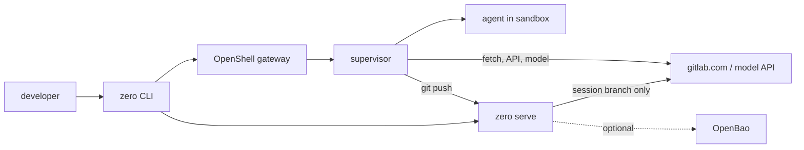

# 28. Target architecture (onion)

Status: proposed (#94). Builds on §2 invariants, §27 control plane, ADR 0024 (DevOps backbone), PoCs 01–11.

## 28.1 Idea in one sentence

The agent works in a sandbox, sees no secret, can only reach what the project allows, and can only change the forge through one narrow door: its own session branch. Everything after that (review, CI, merge, deploy) is the existing DevOps/GitOps process.

## 28.2 Components (three binaries, one dependency)

| Component | Runs | Job |
|---|---|---|
| `zero` CLI | laptop | `zero up/web/code/status/rm/doctor/install`; reads `.zero/policy.yaml` from the host checkout |
| `zero serve` | laptop (user unit) or cluster | the broker: mints/renews/revokes credentials, push gate, decision log. Same binary in both places; laptop instance = "zero-cp of one" |
| OpenShell (dependency) | laptop / cluster | gateway + supervisor: sandbox, egress policy, placeholder substitution |
| optional: OpenBao, SPIRE | cluster | credential storage off the laptop, workload identity |

Today `zero up` does the broker work inline (mint on create, renew on up, revoke on rm). Moving it into `zero serve` is a refactor, not a new design: the push gate (`cmd/zero-push`) and token endpoint (`cmd/zero-cp`) become handlers of `zero serve`.



## 28.3 Layers (inside → out)

Each layer is a feature. L0–L3 are always on; L4+ are switchable per project/org, default on once proven.

| L | Layer | Stops | Inv. | Status |
|---|---|---|---|---|
| 0 | Containment: non-root, Landlock, seccomp, no host mounts, own netns | agent touching host files/processes | Z1, Z5 | proven (PoC 01, containment 45/45) |
| 1 | Egress allowlist: deny by default, project hosts from host checkout, per-binary rules | exfil to non-allowed hosts (not through allowed ones, C18) | Z2, Z5 | proven (PoC 03, `.zero/policy.yaml`) |
| 2 | Placeholders: real credentials only in supervisor, injected at declared placement | secret theft from env/files/memory of agent | Z1, Z4 | proven (GitLab, Copilot #86) |
| 3 | Scoped credentials: one fine-grained token per sandbox, project-only, ≤1 day, renewed, revoked on rm/orphan | blast radius beyond the project; leftover tokens | Z2, Z4 | proven (#70); renew window C44 |
| 4 | Git write gate: push only to session branch, no delete | overwriting/deleting other branches (C43) | Z2, Z3 | PoC 11 (#93); force-push on own branch open |
| 5 | API action gate: OpenShell deny rules for destructive REST (branch/tag delete, settings, members) | REST-side destruction | Z2 | planned |
| 6 | Isolation strength: VM driver per risk (`zero up --vm`) | kernel escape | Z5 | proven (#17); no container build (C48) |
| 7 | Identity + revocation off the laptop: SPIFFE per sandbox, sessions/epochs, OpenBao storage | stolen laptop, offline revocation | Z3, Z4, Z6 | PoC 08/09/10 |
| 8 | Evidence: decision log + OCSF per sandbox → sink | silent misuse, no attribution | Z3, Z6 | partial (local logs only) |
| — | DevOps backbone: protected branches, MR review, CI, GitOps | merging agent work unreviewed | — | not zero (ADR 0024) |

Known holes no layer closes today (L0 also assumes the host follows `docs/host-recommendations.md`, e.g. no docker group): foreign credentials in requests (C18, #14), spam MRs (accepted as reversible), agent-committed hooks run on host checkout (C42), model traffic content.

## 28.4 Use (what a developer types)

```
sudo zero install          # once: OpenShell + zero serve, one sudo
zero up                    # in any repo: sandbox, token, policy, push gate
zero web | zero code       # work with the agent
zero rm                    # revoke + delete
```

Project owners add `.zero/policy.yaml` (hosts, capabilities). Widening asks the developer once (#78). Nothing else to configure; `zero doctor` checks every layer and names the missing one.

## 28.5 Deployments, not modes

| | Laptop | Team |
|---|---|---|
| zero serve | user unit on laptop | in cluster behind HTTPS |
| credential source | developer's glab/OAuth login | GitLab OAuth app, refresh token in OpenBao |
| identity | local session | SPIFFE per sandbox (L7) |
| revocation | `zero rm` / orphan sweep | central, without laptop |

The CLI, policy file and layers are identical; only where `zero serve` runs changes.

## 28.6 Next steps (issues)

1. Move push gate into zero (L4 default) — new issue.
2. OpenShell deny rules for destructive GitLab REST (L5) — new issue.
3. `zero serve` as the single broker process (laptop) — new issue.
4. #78 widening prompt, #88 ADR OpenBao, #91/#92 identity decisions (open questions in `docs/scenarios/identity-broker-usecases.md`).
