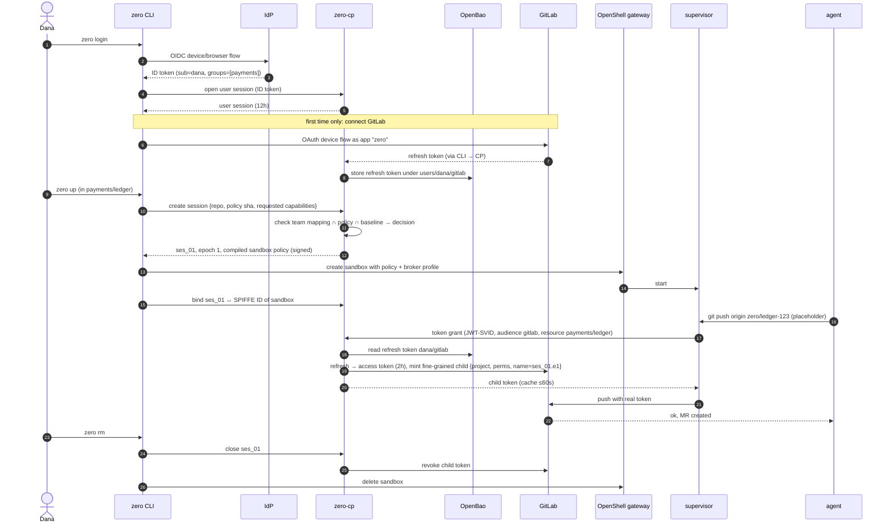
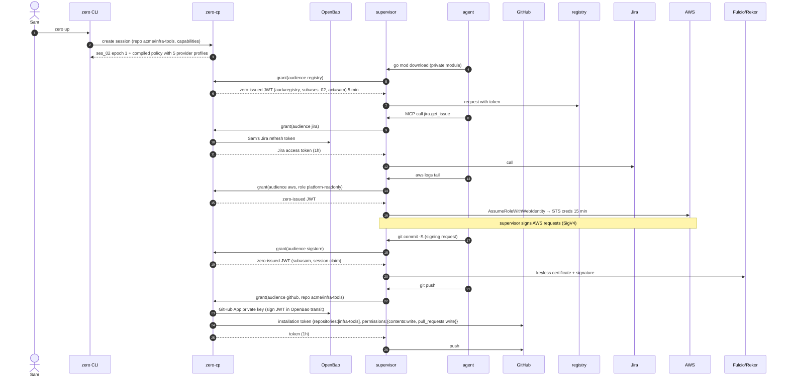

# Identity and credential broker — use cases at organisation scale

Status: **draft for review** (#92). Design exploration, not a decision. Follows #91 (forge identity comparison).

Purpose: walk three complete flows through the proposed target design and find where it breaks.

Legend: ✅ verified by a PoC or live test · 🟡 documented upstream, not tested by us · ❌ does not exist / assumption.

## 0. Setting

Organisation "Acme": 120 developers, 9 teams, GitLab (most repos) and GitHub (two teams), AWS, a private package registry, Jira. Developers use Linux laptops. A platform team (3 people) operates shared services.

### 0.1 Components

| Component | Runs where | Operated by | Holds |
|---|---|---|---|
| `zero` CLI | laptop | developer | user session (short-lived), nothing else |
| OpenShell gateway + supervisor | laptop, dedicated `openshell` user | `zero install` | injected credentials in memory, encrypted provider store ✅ (#87) |
| SPIRE agent | laptop | `zero install` | node key |
| sandbox (agent) | laptop | — | placeholders only ✅ |
| **zero-cp** (broker) | central, 2+ replicas | platform team | sessions, epochs, decision log, signing key of the zero OIDC issuer |
| SPIRE server | central | platform team | trust domain CA |
| OpenBao | central | platform team | refresh tokens, GitHub App key, parent tokens |
| IdP (Keycloak/Entra/GitLab) | central | IT | human identities, groups |
| Policy repo (GitOps) | forge | platform + security team | org baseline, team → project/capability mapping |
| Evidence sink | central | security team | decision log + OCSF events |

A single developer without an organisation runs zero-cp in-process inside the `zero` CLI with the OS keyring as store; the flows are the same with "central" replaced by "local". That mode cannot meet Z-INV-6 (revocation without the laptop).

### 0.2 Identities

| Identity | Format | Issued by | Lifetime |
|---|---|---|---|
| Human | OIDC ID token (`sub`, `groups`) | IdP | 8–12h session |
| Laptop (node) | SPIFFE ID `spiffe://acme/node/<id>` | SPIRE server, node attestation | days, renewed |
| Sandbox | SPIFFE ID `spiffe://acme/sandbox/<sandbox-id>` ✅ (PoC 08) | SPIRE agent, workload attestation | JWT-SVID 5 min |
| Session | `ses_<ulid>`, epoch `n` | zero-cp | until stopped; epoch changes on resume/policy change |
| Provider credential | provider-specific | minted by zero-cp | minutes to 1 day (provider minimum) |

Binding rule: zero-cp grants a sandbox only what **the human who opened the session may do ∩ the project policy ∩ the org baseline**. A sandbox never gets more than its human.

### 0.3 One-time setup

Platform team (once):
1. Deploy zero-cp, SPIRE server, OpenBao; connect zero-cp to the IdP as OIDC client.
2. Create the policy repo: org baseline + team mapping (IdP group → forge groups/projects → max capabilities).
3. Per provider, one trust setup:
   - GitLab: register OAuth application "zero" (device flow 🟡).
   - GitHub: create GitHub App "zero", org admin installs it; private key into OpenBao 🟡.
   - AWS: register zero-cp as OIDC identity provider, role per team with trust condition on claims 🟡.
   - Private registry / Jira: OAuth client or token-exchange trust, depending on product.
4. Publish one line for developers: `curl … | sh && sudo zero install --org https://zero.acme.example`.

Developer (once per laptop): `sudo zero install --org …` → installs binaries, gateway, SPIRE agent; laptop enrols (node attestation, see flaw F1). Then `zero login`.

---

## UC1 — Daily feature work in a team repo (GitLab)

**Actor:** Dana, team Payments. **Goal:** let an agent implement a ticket in `payments/ledger` and open an MR.

**Preconditions:** laptop enrolled; Dana is Developer in `payments/*`; repo has `.zero/policy.yaml` (allow proxy.golang.org; capabilities git.push, gitlab.mr.create, gitlab.pipeline.read).

### Flow

### Step notes

| Step | Detail | Status |
|---|---|---|
| Login | one browser flow; `zero login` also triggers "connect provider" for forges the user has no refresh token for | ❌ not built; OpenBao/zero-cp OIDC against IdP untested |
| Session create | zero-cp, not the CLI, decides capabilities; CLI only proposes (host checkout policy + SHA) | ❌ (today CLI decides) |
| Policy widening | if `.zero/policy.yaml` asks more than last approved for this repo → Dana confirms in CLI; beyond team maximum → denied, needs policy-repo MR | ❌ (#78) |
| Bind | zero-cp needs the sandbox's SPIFFE ID; today one SPIRE entry per sandbox must be created after sandbox create ✅ (PoC 08) — who creates it centrally? see F2 |
| Grant | supervisor → zero-cp with JWT-SVID, `token_grant` profile ✅ (PoC 09 with test token) |
| Mint | GitLab fine-grained child from OAuth access token ✅ (today via glab); from a stored refresh token ❌ untested |
| Token name | `zero/<session>.<epoch>` so GitLab UI shows session | ✅ naming works |
| Use | git, glab (`GLAB_IS_OAUTH2`), MCP with same token ✅ |
| End | revoke on close; zero-cp also revokes on session TTL, heartbeat loss, or admin action | ❌ central; ✅ CLI-side |

### Credential inventory UC1

| Credential | Where | Lifetime | Usable by |
|---|---|---|---|
| IdP ID token | CLI memory / keyring | ≤12h | Dana |
| zero user session | CLI keyring | ≤12h | Dana's CLI |
| GitLab refresh token (classic `api` scope) | OpenBao only | until revoked / unused | zero-cp |
| GitLab access token | zero-cp memory | 2h | zero-cp |
| Fine-grained child token | supervisor memory | session, max 1 day (GitLab minimum expiry is a date) | supervisor of that sandbox |
| Placeholder | sandbox env | session | useless outside the sandbox ✅ |

### Failure paths

- zero-cp unreachable → no new grants → pushes fail closed ✅ (PoC 09: 502). Running requests with a cached token continue ≤ cache TTL; the minted GitLab token itself stays valid until revoked (F5).
- Dana removed from team mid-session → next grant denied; existing child token still valid at GitLab until zero-cp revokes it (needs IdP event or periodic re-check).
- Laptop offline → no forge access anyway; model access also needs the broker unless cached (F7).

---

## UC2 — Cross-provider task: GitHub repo, private packages, Jira, AWS diagnostics, signed commits

**Actor:** Sam, team Platform. **Goal:** agent fixes a bug in `acme/infra-tools` (GitHub), needs a private Go module from the internal registry, reads the Jira ticket through MCP, inspects a failing AWS Lambda's logs read-only, and pushes a signed commit.

**Preconditions:** GitHub App "zero" installed on org `acme`; AWS trusts zero-cp's OIDC issuer; Sam is in IdP group `platform`; project policy lists the capabilities `github.pr.create`, `registry.read`, `jira.issue.read`, `aws.logs.read`.

### Flow

### Step notes

| Step | Detail | Status |
|---|---|---|
| Federated providers (registry, AWS, sigstore) | zero-cp issues its own JWT; provider trusts issuer + claims. No stored secret. | ❌ zero-cp issuer not built; AWS/sigstore accept custom OIDC issuers 🟡 |
| AWS call signing | AWS needs SigV4 per request; OpenShell substitutes headers, not signatures. OpenShell has `aws_sts_assume_role` refresh 🟡 but signing in the supervisor is unverified → F9 |
| Commit signing | signing happens where the key is; agent must not hold a key. Needs a signing helper outside the sandbox or supervisor support → F10 |
| GitHub | installation token per repo + permission, 1h 🟡. Commits/PRs appear as `zero[bot]`, not Sam → attribution via PR body/commit trailer + decision log (F4) |
| Jira | per-user OAuth (3LO) refresh token in OpenBao; MCP server remote, token injected by supervisor ✅ pattern (GitLab MCP), Jira itself untested |
| Five providers | each needs: endpoint allowlist, placement profile, mint function. Provider plugin interface in zero-cp | ✅ interface exists for forges in CLI; ❌ generalised |

### Credential inventory UC2

| Credential | Stored secret? | Where | Lifetime |
|---|---|---|---|
| zero-issued JWT (registry, AWS, sigstore) | no | supervisor memory | 5 min |
| AWS STS credentials | no | supervisor memory | 15 min |
| GitHub App private key | **yes, org-wide** | OpenBao transit (never exported) | rotated manually |
| GitHub installation token | no | supervisor memory | 1h |
| Jira refresh token | yes, per user | OpenBao | until revoked |

### Failure paths

- Sam's repo not covered by App installation → grant denied with reason; CLI prints "ask org admin to add repo to zero app".
- Jira refresh token expired → grant fails → agent gets 401-like error → CLI notification "reconnect Jira: `zero login jira`" (agent cannot do the browser flow).
- AWS trust condition mismatch (wrong team) → STS denies; visible in decision log and CloudTrail.

---

## UC3 — Incident: agent goes rogue, laptop stolen, developer leaves

**Actors:** Riya (security on-call), Dana (developer), platform team.

### 3a. Rogue agent (prompt injection) during Dana's session

1. Agent in `ses_01` starts deleting branches and opening spam MRs in `payments/ledger`.
2. Detection options: GitLab audit/webhook → evidence sink rule (rate of branch deletions by tokens named `zero/*`); or Dana notices.
3. Riya runs `zero admin session quarantine ses_01` (or Dana `zero stop`).
4. zero-cp: marks epoch revoked → denies all further grants (effect ≤ cache TTL 60s) → revokes the GitLab child token via API (effect immediate at GitLab) → asks the gateway on the laptop to freeze the sandbox **if reachable**.
5. Investigation: decision log (every grant: time, session, epoch, SPIFFE ID, audience, resource) + supervisor OCSF log (every request: method, host, path, binary) + GitLab events for token `zero/ses_01.e1`.
6. Recovery: protected branches untouched ✅ (branch protection); deleted unprotected branches restored from reflog/other clones (C43 remains).

What is traceable: human (Dana), session, sandbox, each HTTP request. What is not: which branch a push changed (ref names are in the request body, C43) and the model prompt that caused it unless model traffic is logged (F11).

### 3b. Stolen laptop

1. Dana reports loss. Riya: `zero admin user revoke dana --device <node-id>`.
2. zero-cp: closes all Dana's sessions, revokes all child tokens, revokes Dana's user session; SPIRE server bans the node (SVID renewal stops; existing JWT-SVIDs ≤5 min).
3. Thief with root on the laptop has: encrypted gateway store + KEK on the same disk → can decrypt whatever the gateway stored locally. In the target design the gateway stores **no** long-lived provider secret (only broker profile); injected tokens are in supervisor memory. So the loot is: child tokens of running sandboxes (revoked in step 2), Dana's zero user session (revoked), nothing reusable.
4. Refresh tokens are in OpenBao, unreachable without a valid user session + node identity.

Today (laptop-minting): thief gets glab's OAuth refresh token in plaintext config → full `api` access as Dana until Dana revokes it in GitLab. This is the main gain of the central design.

### 3c. Offboarding

1. IT disables Dana in the IdP.
2. zero-cp learns via SCIM/webhook or at next token refresh/introspection (F6): closes sessions, revokes child tokens, deletes `users/dana/*` in OpenBao, revokes refresh tokens at providers.
3. GitHub (App tokens): nothing user-specific to revoke; grants stop because the user session is gone.
4. Audit record: who revoked, when, which tokens.

---

## Flaws found

Severity: **H** breaks an invariant or blocks the design · **M** real cost or risk, workable · **L** nuisance.

| # | Sev | Flaw | Why it matters | Candidate answer / open question |
|---|---|---|---|---|
| F1 | H | **Laptop node attestation.** SPIRE needs to trust each of 120 laptops. Join tokens don't scale and are bearer secrets; TPM attestation needs TPM enrolment; x509pop needs device certs (MDM). | Without it, sandbox SPIFFE IDs from a laptop prove nothing centrally. | Tie node enrolment to the human: `zero login` → zero-cp issues a join token for *this* device, node ID carries the user. Then sandbox identity is only as strong as "Dana's laptop", which matches the binding rule (sandbox ≤ human). TPM later. ❌ untested |
| F2 | H | **Who registers sandbox SPIRE entries?** PoC 08: one entry per sandbox created on the SPIRE server after sandbox create. Centrally this means the CLI (developer) asks zero-cp to create entries → developer can ask for arbitrary selectors. And C49: whoever owns the podman socket can forge labels. | Trust boundary is the laptop's `openshell` user, not the sandbox. | Accept explicitly: identity granularity that zero-cp can *trust* is (human, device); sandbox ID is for attribution and for separating concurrent sessions, not a security boundary against the laptop owner. Design must never grant a sandbox more than its human. Alternative: nested SPIRE per laptop. |
| F3 | H | **zero-cp + OpenBao become the crown jewels.** They hold `api`-scope refresh tokens for 120 users and the org GitHub App key. | Compromise = everything every developer can do, on all forges. Today's design spreads that risk across laptops. | Per-user encryption in OpenBao bound to the user's active session (refresh token usable only while the user is logged in); GitHub App key in transit engine, never exported; zero-cp has no standing read on other users' paths (OpenBao templated policies on the OIDC `sub`). Disappears per provider when granular OAuth / federation exists. Needs threat model + ADR. |
| F4 | M | **Attribution differs per provider.** GitLab: actions are Dana's. GitHub App: actions are `zero[bot]`. | "Who did this" differs by forge; reviewers may be unable to approve their "own" bot PR or, worse, *can* approve their own agent's PR (four-eyes bypass). | Commit trailers `Zero-Session`, `On-behalf-of`; PR body stamped by zero-cp; branch protection "require approval from someone other than last pusher" does not cover bot-pushed code → document as org guardrail in `zero doctor`. GitHub user-to-server tokens (expire 8h, act as user, limited to App permissions ∩ user permissions) may be the better fit 🟡 — to verify. |
| F5 | M | **Provider minimum lifetimes.** GitLab PAT expiry is a date (≥ end of day), GitHub installation token 1h, Jira 1h. "Minutes" is only true for federated providers. | Revocation must be an explicit API call that can fail (provider down, zero-cp down). | Revocation queue with retries + alert on failure; orphan sweep by token name prefix ✅ (exists in CLI); report residual lifetime honestly. |
| F6 | M | **Human session liveness.** IdP disable does not reach zero-cp unless there is SCIM/back-channel logout or short user sessions. | Offboarded user's running sandbox keeps working until session TTL. | Short user session (≤1h) with silent refresh; IdP refresh failure closes sessions. |
| F7 | M | **Availability.** Every credentialed request depends on zero-cp (+ SPIRE, OpenBao, IdP). 120 developers stop if it is down; laptops on trains/VPN-less networks. | Central SPOF for all agent work, including model access if models are brokered. | Grant cache TTL per provider class (model access longer than forge writes); HA; local mode fallback is a policy decision (security team may forbid). |
| F8 | M | **Rate limits and quotas.** 120 devs × several sandboxes × token mint per session; GitLab token creation and GitHub App installation-token rate limits; fine-grained PAT count per user. | Throttling looks like random auth failures to the agent. | Cache per (session, provider, resource); measure limits before committing. ❌ unmeasured |
| F9 | M | **Request signing providers (AWS SigV4, some registries).** OpenShell injects headers; it does not sign requests. | Agent would need real STS keys in the sandbox → breaks "agent never sees credentials". | Check OpenShell `aws_sts_assume_role` behaviour 🟡; else STS creds in sandbox with 15 min life and read-only role (accept as caveat) or a signing proxy. To verify. |
| F10 | M | **Commit signing.** Keyless signing needs the JWT at signing time on the machine that signs; gitsign in the sandbox would need the zero-issued token inside the sandbox. | Either the agent holds a (short-lived, audience-bound) identity token, or signing moves to the supervisor/host. | Audience-restricted 5-min JWT usable only at Fulcio is low risk but is still "agent holds a credential" → needs explicit ADR. Alternative: sign on push by a host-side helper. |
| F11 | M | **Model traffic is outside the evidence chain.** Prompts/responses go to the model API; nothing ties a tool action to the prompt that caused it. | Cannot reconstruct *why* in 3a. | AI control plane / LLM gateway (arch §15) as another brokered provider; out of scope now, note it. |
| F12 | M | **Provider plugin sprawl.** Each provider = login flow + mint + revoke + OpenShell profile + capability map + doctor checks. | Maintenance for a 3-person platform team; quality differs per provider. | Tiers: *federated* (generic, config only: issuer trust + audience), *OAuth generic* (config only: endpoints + scopes; token is user-scoped, no attenuation), *native* (code: GitLab, GitHub). Only native ones need code. |
| F13 | M | **Capability vocabulary across providers.** `git.push`, `gitlab.mr.create`, `github.pr.create`, `aws.logs.read` … | Policy files become provider-specific; team mapping hard to review. | Generic verbs for forges (`forge.change.create`), provider-specific only where unavoidable; keep the set small (arch principle). |
| F14 | M | **Team mapping source of truth.** IdP groups vs forge membership vs policy repo can disagree. | zero-cp grants what the forge would deny, or denies what the forge allows → confusion. | Forge membership stays authoritative for forge access (token ⊆ user's rights ✅ enforced by GitLab attenuation); policy repo only *reduces*. Don't duplicate membership in zero. |
| F15 | L | **Multiple devices / multiple sandboxes per user.** Token names, session listing, "which laptop". | UX and cleanup. | Session ID carries device; `zero ls --all` from zero-cp. |
| F16 | L | **First-run friction.** "Connect GitLab", "connect Jira", … one browser flow per provider. | 5 prompts on day one. | `zero login` connects all providers the org marks default, sequentially, once. |
| F17 | H | **Agent can drive any allowed capability at machine speed.** The broker authorises by capability, not by intent. A rogue agent with `git.push` + `mr.create` can do all of 3a legitimately. | Central design does not reduce *what* a session can do versus today; it improves revocation and evidence only. | Rate/anomaly rules in zero-cp per session (grants per minute, distinct resources), step-up approval for destructive verbs (branch delete, force push) where the provider API allows distinguishing them — for git push it does not (C43). |
| F18 | M | **Setup is no longer "simple" for the platform team.** zero-cp, SPIRE server, OpenBao (unseal, backup, HA), IdP client, policy repo, per-provider trust. | Contradicts "simple to set up" for the organisation, even though the developer side stays one command. | Ship as one Helm chart / compose bundle with OpenBao + SPIRE embedded defaults; or drop SPIRE centrally (see alternative below). |

### Alternative worth comparing: no central SPIRE

F1, F2 and F18 all come from carrying sandbox SPIFFE identity to a central service. A leaner variant:

- Laptop keeps its local SPIRE (or none) only between supervisor and the **local** gateway/broker shim.
- The laptop authenticates to central zero-cp with the **human's user session** plus a device key created at `zero login` (DPoP-style proof of possession), and names the session.
- zero-cp trusts (human, device), which is all it could really trust anyway (F2), and still issues per-session, per-resource credentials.

Loses: cryptographic per-sandbox identity at the centre. Keeps: one login, central store, revocation, evidence, per-session tokens. Removes: central SPIRE server, node attestation problem. This fits laptops; Kubernetes deployments keep SPIRE where node attestation is solved.

## Open questions for review

1. Is (human, device) as the trusted unit acceptable, with sandbox identity for attribution only (F2)?
2. Central store of `api`-scope refresh tokens (F3): acceptable with per-user binding, or wait for granular OAuth and keep laptop minting until then?
3. GitHub: bot identity (App installation token) or user identity (user-to-server token) (F4)?
4. Commit signing: may the sandbox hold a 5-minute, audience-bound signing token (F10)?
5. Central SPIRE or the leaner variant for laptops?
