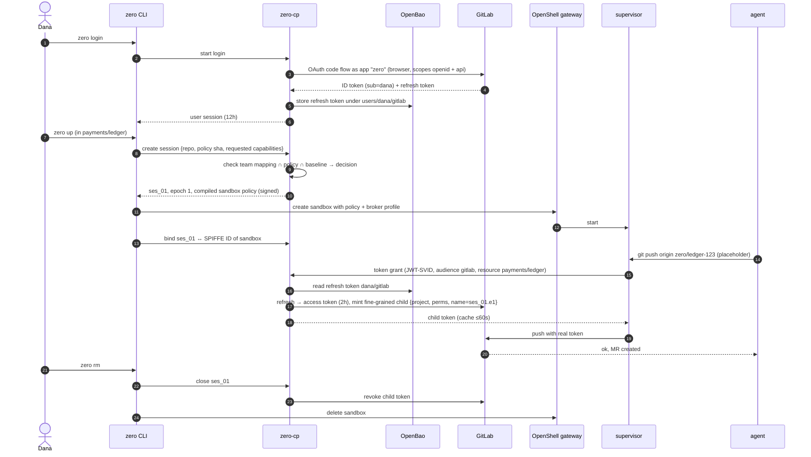
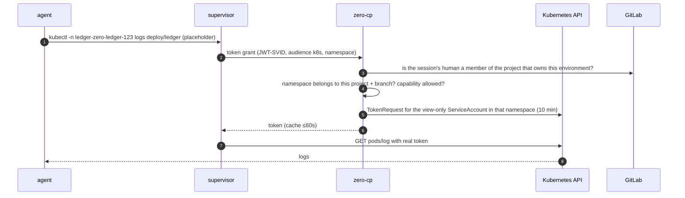

# Identity and credential broker — use cases at organisation scale

Status: **draft for review** (#92). Design exploration, not a decision. Follows #91 (forge identity comparison).

Scope: **GitLab + Kubernetes only.** GitLab is the login and the forge; Kubernetes is the GitOps target whose branch/QA environments the agent may read. GitHub, AWS, Jira, private registries and keyless signing were in an earlier draft and are out of scope; flaw numbers are kept stable, dropped ones are marked.

Purpose: walk three complete flows through the proposed target design and find where it breaks.

Legend: ✅ verified by a PoC or live test · 🟡 documented upstream, not tested by us · ❌ does not exist / assumption.

## 0. Setting

Organisation "Acme": 120 developers, 9 teams, all repos on GitLab, deployment by GitOps to Kubernetes (one namespace per branch environment, plus QA). Developers use Linux laptops. A platform team (3 people) operates shared services in the cluster.

### 0.1 Components

| Component | Runs where | Operated by | Holds |
|---|---|---|---|
| `zero` CLI | laptop | developer | user session (short-lived), nothing else |
| OpenShell gateway + supervisor | laptop, dedicated `openshell` user | `zero install` | injected credentials in memory, encrypted provider store ✅ (#87) |
| SPIRE agent | laptop | `zero install` | node key |
| sandbox (agent) | laptop | — | placeholders only ✅ |
| **zero-cp** (broker) | Kubernetes, 2+ replicas, HTTPS ingress | platform team | sessions, epochs, decision log |
| SPIRE server | central | platform team | trust domain CA |
| OpenBao | central | platform team | GitLab refresh tokens |
| GitLab | SaaS / central | IT | human identities, group and project membership; OAuth application "zero" |
| Policy repo (GitOps) | forge | platform + security team | org baseline, team → project/capability mapping |
| Evidence sink | central | security team | decision log + OCSF events |

A single developer without an organisation runs zero-cp in-process inside the `zero` CLI with the OS keyring as store; the flows are the same with "central" replaced by "local". That mode cannot meet Z-INV-6 (revocation without the laptop).

### 0.2 Identities

| Identity | Format | Issued by | Lifetime |
|---|---|---|---|
| Human | GitLab OIDC ID token (`sub`, groups) | GitLab | 8–12h session |
| Laptop (node) | SPIFFE ID `spiffe://acme/node/<id>` | SPIRE server, node attestation | days, renewed |
| Sandbox | SPIFFE ID `spiffe://acme/sandbox/<sandbox-id>` ✅ (PoC 08) | SPIRE agent, workload attestation | JWT-SVID 5 min |
| Session | `ses_<ulid>`, epoch `n` | zero-cp | until stopped; epoch changes on resume/policy change |
| Provider credential | provider-specific | minted by zero-cp | minutes to 1 day (provider minimum) |

Binding rule: zero-cp grants a sandbox only what **the human who opened the session may do ∩ the project policy ∩ the org baseline**. A sandbox never gets more than its human.

### 0.3 One-time setup

Platform team (once):
1. Deploy zero-cp, SPIRE server, OpenBao to the cluster; expose zero-cp at `https://zero.acme.example`.
2. Register one OAuth application "zero" in the GitLab top-level group (scopes `openid`, `api`; redirect to zero-cp) 🟡. This is the only identity setup: GitLab is the IdP, no second one.
3. Create the policy repo: org baseline + maximum capabilities per GitLab group.
4. Kubernetes: a view-only Role without Secret access in each branch/QA namespace (part of the GitOps templates), and permission for zero-cp to request short-lived tokens for it 🟡.
5. Publish one line for developers: `curl … | sh && sudo zero install --org https://zero.acme.example`.

Developer (once per laptop): `sudo zero install --org …` → installs binaries, gateway, SPIRE agent; laptop enrols (node attestation, see flaw F1). Then `zero login` (one browser click at GitLab).

---

## UC1 — Daily feature work in a team repo (GitLab)

**Actor:** Dana, team Payments. **Goal:** let an agent implement a ticket in `payments/ledger` and open an MR.

**Preconditions:** laptop enrolled; Dana is Developer in `payments/*`; repo has `.zero/policy.yaml` (allow proxy.golang.org; capabilities git.push, gitlab.mr.create, gitlab.pipeline.read).

### Flow

### Step notes

| Step | Detail | Status |
|---|---|---|
| Login | one browser flow gives identity and the GitLab connection in one step; the refresh token never reaches the laptop | ❌ not built; group OAuth app with `openid`+`api` on gitlab.com Free 🟡 untested |
| Session create | zero-cp, not the CLI, decides capabilities; CLI only proposes (host checkout policy + SHA) | ❌ (today CLI decides) |
| Policy widening | if `.zero/policy.yaml` asks more than last approved for this repo → Dana confirms in CLI; beyond team maximum → denied, needs policy-repo MR | ❌ (#78) |
| Bind | zero-cp needs the sandbox's SPIFFE ID; today one SPIRE entry per sandbox must be created after sandbox create ✅ (PoC 08) — who creates it centrally? see F2 |
| Grant | supervisor → zero-cp with JWT-SVID, `token_grant` profile ✅ (PoC 09 with test token) |
| Mint | GitLab fine-grained child from OAuth access token ✅ (today via glab); from a stored refresh token ❌ untested |
| Token name | `zero/<session>.<epoch>` so GitLab UI shows session | ✅ naming works |
| Use | git, glab (`GLAB_IS_OAUTH2`), MCP with same token ✅ |
| End | revoke on close; zero-cp also revokes on session TTL, heartbeat loss, or admin action | ❌ central; ✅ CLI-side |

### Credential inventory UC1

| Credential | Where | Lifetime | Usable by |
|---|---|---|---|
| zero user session | CLI keyring | ≤12h | Dana's CLI |
| GitLab refresh token (classic `api` scope) | OpenBao only | until revoked / unused | zero-cp |
| GitLab access token | zero-cp memory | 2h | zero-cp |
| Fine-grained child token | supervisor memory | session, max 1 day (GitLab minimum expiry is a date) | supervisor of that sandbox |
| Placeholder | sandbox env | session | useless outside the sandbox ✅ |

### Failure paths

- zero-cp unreachable → no new grants → pushes fail closed ✅ (PoC 09: 502). Running requests with a cached token continue ≤ cache TTL; the minted GitLab token itself stays valid until revoked (F5).
- Dana removed from team mid-session → next grant denied; existing child token still valid at GitLab until zero-cp revokes it (needs a periodic membership re-check).
- Laptop offline → no forge access anyway.

---

## UC2 — Read the branch environment (GitOps, Kubernetes)

**Actor:** Dana, same session as UC1. **Goal:** the agent pushed `zero/ledger-123`; GitOps deployed it to namespace `ledger-zero-ledger-123`; the pod crash-loops. The agent reads pod status, events and logs to fix its own change. It never deploys or changes anything in the cluster.

**Preconditions:** project policy lists capability `k8s.env.read`; the policy repo allows it for group `payments`; the namespace has the view-only Role from the GitOps template.

### Flow

### Step notes

| Step | Detail | Status |
|---|---|---|
| Capability | `k8s.env.read` = get/list/watch pods, events, deployments, logs in the session's branch/QA namespaces. No Secrets, no exec, no port-forward, no writes | ❌ not built |
| Namespace ownership | zero-cp must know which namespaces belong to which project/branch: naming convention or labels set by the GitOps templates (F24) | ❌ |
| Human check | sandbox ≤ human: GitLab project membership is the source of truth, no separate K8s user mapping | ❌ |
| Mint | Kubernetes TokenRequest, bound ServiceAccount token, minimum 10 min 🟡 | ❌ untested |
| Inject | bearer placement on the cluster API host, same pattern as GitLab ✅ pattern; `kubectl logs -f` (long-lived stream) through the supervisor untested | ❌ |
| Evidence | Kubernetes audit log shows the ServiceAccount; zero-cp decision log maps it to session + human | ❌ |

### Credential inventory UC2

| Credential | Stored secret? | Where | Lifetime |
|---|---|---|---|
| ServiceAccount token (view-only, one namespace) | no | supervisor memory | 10 min |
| zero-cp's own right to request tokens | no (its pod identity) | cluster | — |

### Failure paths

- Namespace not owned by the session's project → denied with reason.
- Environment not deployed yet → Kubernetes 404; agent waits for the pipeline (`gitlab.pipeline.read`).
- Cluster API not reachable from the laptop (private cluster, VPN) → F25.

---

## UC3 — Incident: agent goes rogue, laptop stolen, developer leaves

**Actors:** Riya (security on-call), Dana (developer), platform team.

### 3a. Rogue agent (prompt injection) during Dana's session

1. Agent in `ses_01` starts deleting branches and opening spam MRs in `payments/ledger`.
2. Detection options: GitLab audit/webhook → evidence sink rule (rate of branch deletions by tokens named `zero/*`); or Dana notices.
3. Riya runs `zero admin session quarantine ses_01` (or Dana `zero stop`).
4. zero-cp: marks epoch revoked → denies all further grants (effect ≤ cache TTL 60s) → revokes the GitLab child token via API (effect immediate at GitLab) → asks the gateway on the laptop to freeze the sandbox **if reachable**.
5. Investigation: decision log (every grant: time, session, epoch, SPIFFE ID, audience, resource) + supervisor OCSF log (every request: method, host, path, binary) + GitLab events for token `zero/ses_01.e1`.
6. Recovery: protected branches untouched ✅ (branch protection); deleted unprotected branches restored from reflog/other clones (C43 remains).

What is traceable: human (Dana), session, sandbox, each HTTP request. What is not: which branch a push changed (ref names are in the request body, C43) and the model prompt that caused it unless model traffic is logged (F11).

### 3b. Stolen laptop

1. Dana reports loss. Riya: `zero admin user revoke dana --device <node-id>`.
2. zero-cp: closes all Dana's sessions, revokes all child tokens, revokes Dana's user session and Kubernetes grants stop; SPIRE server bans the node (SVID renewal stops; existing JWT-SVIDs ≤5 min).
3. Thief with root on the laptop has: encrypted gateway store + KEK on the same disk → can decrypt whatever the gateway stored locally. In the target design the gateway stores **no** long-lived provider secret (only broker profile); injected tokens are in supervisor memory. So the loot is: child tokens of running sandboxes (revoked in step 2), Dana's zero user session (revoked), nothing reusable.
4. Refresh tokens are in OpenBao, unreachable without a valid user session + node identity.

Today (laptop-minting): thief gets glab's OAuth refresh token in plaintext config → full `api` access as Dana until Dana revokes it in GitLab. This is the main gain of the central design.

### 3c. Offboarding

1. IT blocks Dana in GitLab.
2. zero-cp learns at the next token refresh (fails) (F6): closes sessions, revokes child tokens, deletes `users/dana/*` in OpenBao, revokes refresh tokens at providers.
3. Audit record: who revoked, when, which tokens.

---

## Flaws found

Severity: **H** breaks an invariant or blocks the design · **M** real cost or risk, workable · **L** nuisance.

| # | Sev | Flaw | Why it matters | Candidate answer / open question |
|---|---|---|---|---|
| F1 | H | **Laptop node attestation.** SPIRE needs to trust each of 120 laptops. Join tokens don't scale and are bearer secrets; TPM attestation needs TPM enrolment; x509pop needs device certs (MDM). | Without it, sandbox SPIFFE IDs from a laptop prove nothing centrally. | Tie node enrolment to the human: `zero login` → zero-cp issues a join token for *this* device, node ID carries the user. Then sandbox identity is only as strong as "Dana's laptop", which matches the binding rule (sandbox ≤ human). TPM later. ❌ untested |
| F2 | H | **Who registers sandbox SPIRE entries?** PoC 08: one entry per sandbox created on the SPIRE server after sandbox create. Centrally this means the CLI (developer) asks zero-cp to create entries → developer can ask for arbitrary selectors. And C49: whoever owns the podman socket can forge labels. | Trust boundary is the laptop's `openshell` user, not the sandbox. | Accept explicitly: identity granularity that zero-cp can *trust* is (human, device); sandbox ID is for attribution and for separating concurrent sessions, not a security boundary against the laptop owner. Design must never grant a sandbox more than its human. Alternative: nested SPIRE per laptop. |
| F3 | H | **zero-cp + OpenBao become the crown jewels.** They hold `api`-scope GitLab refresh tokens for 120 users, and zero-cp can request tokens for every branch namespace. | Compromise = everything every developer can do on GitLab. Today's design spreads that risk across laptops. | Per-user encryption in OpenBao bound to the user's active session; zero-cp has no standing read on other users' paths (OpenBao templated policies on `sub`). Disappears when GitLab granular OAuth tokens ship. Needs threat model + ADR. |
| F4 | — | *dropped (GitHub out of scope).* Remaining point: an agent MR is authored by the human, so the human must not be the only approver → org guardrail for `zero doctor`. | | |
| F5 | M | **Provider minimum lifetimes.** GitLab PAT expiry is a date (≥ end of day); Kubernetes token ≥10 min. | Revocation at GitLab must be an explicit API call that can fail (GitLab down, zero-cp down). | Revocation queue with retries + alert on failure; orphan sweep by token name prefix ✅ (exists in CLI); report residual lifetime honestly. |
| F6 | M | **Human session liveness.** Blocking a user in GitLab does not reach zero-cp by itself. | Offboarded user's running sandbox keeps working until session TTL. | Short user session (≤1h) with silent refresh against GitLab; refresh failure closes sessions. |
| F7 | M | **Availability.** Every credentialed request depends on zero-cp (+ SPIRE, OpenBao, GitLab). 120 developers stop if it is down. | Central SPOF for all agent work. | Grant cache TTL; HA; local mode fallback is a policy decision (security team may forbid). |
| F8 | M | **Rate limits and quotas.** 120 devs × several sandboxes × token mint per session; GitLab token creation limits; fine-grained PAT count per user. | Throttling looks like random auth failures to the agent. | Cache per (session, resource); measure limits before committing. ❌ unmeasured |
| F9 | — | *dropped (AWS out of scope).* | | |
| F10 | M | **Commit signing** (planned F21). The agent must not hold a signing key. | Unsigned or agent-held-key commits weaken attribution. | Sign outside the sandbox (host-side helper or supervisor) or let GitLab sign via web commits; needs its own design + ADR. |
| F11 | M | **Model traffic is outside the evidence chain.** Prompts/responses go to the model API; nothing ties a tool action to the prompt that caused it. | Cannot reconstruct *why* in 3a. | AI control plane / LLM gateway (arch §15) as another brokered provider; out of scope now, note it. |
| F12 | — | *dropped (two providers only: GitLab, Kubernetes; both native code).* | | |
| F13 | L | **Capability vocabulary.** Small fixed set: `git.*`, `gitlab.*`, `k8s.env.read`. | Must stay small to be reviewable. | Add verbs only with an ADR. |
| F14 | M | **Source of truth for access.** GitLab membership vs policy repo can disagree. | zero-cp grants what GitLab would deny, or denies what GitLab allows → confusion. | GitLab membership stays authoritative (token ⊆ user's rights ✅ enforced by GitLab attenuation; K8s read follows project membership); policy repo only *reduces*. Don't duplicate membership in zero. |
| F15 | L | **Multiple devices / multiple sandboxes per user.** Token names, session listing, "which laptop". | UX and cleanup. | Session ID carries device; `zero ls --all` from zero-cp. |
| F16 | — | *dropped (one login covers everything).* | | |
| F17 | H | **Agent can drive any allowed capability at machine speed.** The broker authorises by capability, not by intent. A rogue agent with `git.push` + `mr.create` can do all of 3a legitimately. | Central design does not reduce *what* a session can do versus today; it improves revocation and evidence only. | Rate/anomaly rules in zero-cp per session (grants per minute, distinct resources), step-up approval for destructive verbs (branch delete, force push) where the provider API allows distinguishing them — for git push it does not (C43). |
| F18 | M | **Setup is no longer "simple" for the platform team.** zero-cp, SPIRE server, OpenBao (unseal, backup, HA), GitLab app, policy repo, K8s roles. | Contradicts "simple to set up" for the organisation, even though the developer side stays one command. | Ship as one Helm chart with OpenBao + SPIRE embedded defaults; or drop SPIRE centrally (see alternative below). |
| F19 | M | **Revocation window on a stolen/rooted laptop (3b).** Tokens in supervisor memory can be extracted and used until the provider-side revoke lands (report delay + API call). "Nothing reusable" is only true after that. | Window = time to report + revoke; GitLab child token otherwise valid up to a day. | Heartbeat from laptop to zero-cp; missed heartbeats auto-revoke. Keeps window ≈ heartbeat interval. |
| F20 | M | **Policy change during a session.** Org baseline or team mapping is tightened while sessions run; flows only check at session create. | Running sessions keep old, wider rights. | Policy version in the session; zero-cp re-evaluates on policy-repo change → new epoch or session close. |
| F21 | — | *dropped (GitHub out of scope).* | | |
| F22 | M | **Logs contain secrets.** The view Role excludes Secret objects, but applications print tokens and connection strings. | Agent (and model provider) sees them. | Sanitising of Kubernetes output (arch §16, Phase 0 item 10); QA/branch environments must use non-production secrets — org guardrail. |
| F23 | M | **Log and event content is untrusted input.** Anything that can write to the app's logs can inject instructions (same as P15 for GitLab content). | Prompt injection path into a session that can push. | No technical fix here; damage stays bounded by the session's capabilities. Record as attack path. |
| F24 | M | **Namespace ownership.** zero-cp must map namespace → project + branch reliably. | Wrong mapping = reading another team's environment. | Labels written by the GitOps templates (project id, branch), verified by zero-cp; never derived from a name the agent supplies. |
| F25 | L | **Cluster API reachability.** Private clusters are not reachable from laptops without VPN. | Capability unusable for some developers. | zero-cp as read proxy for the allowed verbs instead of handing out a token — also removes the token from the laptop. Open. |

Review (subagent) also noted: detection rules in 3a are GitLab-only and cover one action type — detection is not designed here (belongs to evidence, arch §18).

### Alternative worth comparing: no central SPIRE

F1, F2 and F18 all come from carrying sandbox SPIFFE identity to a central service. A leaner variant:

- Laptop keeps its local SPIRE (or none) only between supervisor and the **local** gateway/broker shim.
- The laptop authenticates to central zero-cp with the **human's user session** plus a device key created at `zero login` (DPoP-style proof of possession), and names the session.
- zero-cp trusts (human, device), which is all it could really trust anyway (F2), and still issues per-session, per-resource credentials.

Loses: cryptographic per-sandbox identity at the centre. Keeps: one login, central store, revocation, evidence, per-session tokens. Removes: central SPIRE server, node attestation problem. This fits laptops; Kubernetes deployments keep SPIRE where node attestation is solved.

## Open questions for review

1. Is (human, device) as the trusted unit acceptable, with sandbox identity for attribution only (F2)?
2. Central store of `api`-scope refresh tokens (F3): acceptable with per-user binding, or wait for granular OAuth and keep laptop minting until then?
3. Kubernetes read: short-lived token to the laptop, or zero-cp as read proxy (F25)?
4. Central SPIRE or the leaner variant for laptops?
